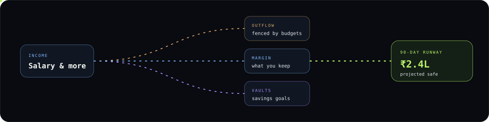
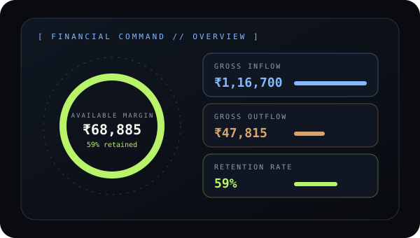

<div align="center">



<br/>

<a href="#-financial-command-center"></a>
<a href="#-transaction-ledger"></a>
<a href="#-cash-runway-forecast"></a>
<a href="#-decision-lens"></a>
<a href="#-budgets--savings-vaults"></a>


**[Features](#-features)** · **[How money flows](#-how-money-flows)** · **[Try it in 60 seconds](#-try-it-in-60-seconds)** · **[Run it](#-run-locally)** · **[Tech](#%EF%B8%8F-tech-stack)**

</div>


## ✦ What is MARGIN?

MARGIN is a personal finance studio built for India (₹). It doesn't just show where your money went — it helps you see **what your money can do next**: how much you keep each month, where your balance will be in 90 days, and what a purchase really costs *before* you make it.

It all sits inside a cinematic dark interface: a 3D money universe on the landing page, motion-led pages, glowing charts and live counters.

> [!TIP]
> The animations in this README are lightweight SVG files — crisp at any size, no GIFs. The real 3D scene, custom cursor and scroll effects run inside the app.


## ◈ How money flows



Every page reads from the same ledger, so a transaction you record shows up instantly in your dashboard, budgets, forecast and insights.


## ✧ Features

### 📊 Financial Command Center

<table>
<tr>
<td width="55%"></td>
<td>

Your month at a glance:

- **Available margin** in a glowing orbit gauge
- Income, expenses and **retention (savings) rate**, compared with last month
- 6-month **inflow vs outflow** chart
- Spending by **category**, **daily spending rhythm** and **top merchants**
- Recent activity and **upcoming bills**
- Step back through previous months

</td>
</tr>
</table>

### 📒 Transaction Ledger

Add, edit and delete income and expenses with 18 Indian-friendly categories. **Search**, filter by type or category, sort by date or amount, and **export to CSV**. A **Record Event** button in the top bar lets you add a transaction from any page.

### 📈 Cash Runway Forecast

<table>
<tr>
<td>

See where your balance is heading over **30, 60 or 90 days**.

- Uses your scheduled salary, rent, subscriptions and SIPs
- Shows today's balance, the projected balance and the **lowest point**
- Warns you if your balance is about to dip **below zero**
- Lists every upcoming payment in the window

</td>
<td width="55%"></td>
</tr>
</table>

### 🔍 Decision Lens

<table>
<tr>
<td width="55%"></td>
<td>

**Before you spend, simulate it.** Enter an amount and a category, and MARGIN compares three choices:

- ✅ **Buy now** — what's left of your margin, and the hit to that category's budget
- ⏳ **Save 30 days** — wait and keep this month intact
- 🏦 **Direct to vault** — put the money into a savings goal instead

You can also spread a purchase over monthly instalments and see how much it delays a goal.

</td>
</tr>
</table>

### 🐷 Budgets & Savings Vaults

<table>
<tr>
<td>

**Budget Studio** — set a monthly limit for each category. Progress bars change colour as you spend, and MARGIN flags categories that are **near capacity (80%)** or **over budget (100%)**.

**Savings Vaults** — create goals with an icon, colour and target date. Add or withdraw money, watch progress fill up, and see the **amount left** and an **estimated finish month**.

</td>
<td width="55%"></td>
</tr>
</table>

### 🧩 And also

| | Feature | What it does |
|:-:|---|---|
| 📅 | **Calendar & recurring payments** | Weekly, monthly or yearly bills and income, a monthly calendar of due dates, and pause / resume |
| 💡 | **Money Intelligence** | Plain-language insights from your history: savings rate, spending jumps, dining, subscriptions and budget warnings |
| 🌐 | **13 languages** | ਪੰਜਾਬੀ (default), हिन्दी, বাংলা, தமிழ், తెలుగు, मराठी, ગુજરાતી, ಕನ್ನಡ, മലയാളം, ଓଡ଼ିଆ, اردو (right-to-left), অসমীয়া and English |
| ⚙️ | **Settings** | Switch language, see how much data you have, and reset to the demo data |
| 🌌 | **3D landing page** | Three.js money universe, orbiting coins, a 3D piggy vault, scroll storytelling and a custom cursor |
| 📱 | **Responsive** | Collapsible sidebar on desktop, bottom navigation on mobile |

<details>
<summary><b>🧭 App map</b> (click to open)</summary>
<br/>

```text
MARGIN
├── Home ─ cinematic 3D landing page
└── Studio
    ├── 01 Overview        ← Financial Command Center
    ├── 02 Transactions
    ├── 03 Budgets
    ├── 04 Forecast
    ├── 05 Vaults & Goals
    ├── 06 Calendar
    ├── 07 Intelligence
    ├── 08 Decision Lens
    └── 09 Settings
```

</details>


## 🎬 Try it in 60 seconds

<details>
<summary><b>A quick tour for demos and judges</b> (click to open)</summary>
<br/>

1. Open the landing page and scroll — the 3D money universe and piggy vault react as you go.
2. Press **Enter Command** to open the studio. It starts with realistic demo data, so nothing is empty.
3. On **Overview**, check the margin orbit and the 6-month chart.
4. Click **Record Event** in the top bar and add a ₹2,000 dining expense — watch the numbers update.
5. Open **Budgets** and see the Dining bar turn to a warning.
6. Open **Forecast** and switch between **30D / 60D / 90D**.
7. Open **Decision Lens**, enter ₹35,000 and compare the three choices.
8. Change the language from the top bar — try ਪੰਜਾਬੀ or हिन्दी.

</details>


## 🚀 Run locally

> [!NOTE]
> No hosted demo yet. The app lives in the `margin-app` folder.

```bash
git clone https://github.com/<your-username>/Think-To-Build.git
cd Think-To-Build/margin-app
npm install
npm run dev
```

Open **http://localhost:3000** for the landing page, or go straight to the studio at **http://localhost:3000/app**.

<details>
<summary><b>📦 Production build</b></summary>
<br/>

```bash
npm run build
npm run start
```

</details>

## 🛠️ Tech stack

| Area | Built with |
|---|---|
| App | Next.js 15 · React 19 · TypeScript |
| Styling | Tailwind CSS 4 |
| 3D | Three.js |
| Motion | Motion for React |
| Charts | Recharts |
| State | Zustand (saved in your browser) |
| Forms & UI | Zod · Radix UI · Lucide icons · Sonner toasts · date-fns |

<details>
<summary><b>📁 Project structure</b></summary>
<br/>

```text
margin-app/src
├── app/              # landing page (/) and studio (/app)
├── components/
│   ├── app/          # studio pages: overview, transactions, budgets, …
│   └── core/         # 3D scenes, orbit gauge, page heroes, cursor, language switcher
├── lib/              # money maths, demo data, translations
├── store/            # Zustand store, saved to local storage
└── types/            # transaction, budget, goal and recurring types
```

</details>

## 🔒 Privacy

- Your data is stored **only in your browser** (local storage) — there is no server, account or bank connection.
- Amounts are stored as whole paise, so totals never pick up rounding errors.
- Please don't type real bank passwords or card numbers into a demo build.

## 🗺️ Roadmap

- [ ] Screen recordings from the running app
- [ ] Automated unit and browser tests
- [ ] Full translation review for every page
- [ ] Accessibility and reduced-motion pass across the studio


<div align="center">

### MARGIN
**See every move. Understand every possibility.**

<sub>Made for Think-To-Build · ₹ first, India first.</sub>

</div>
